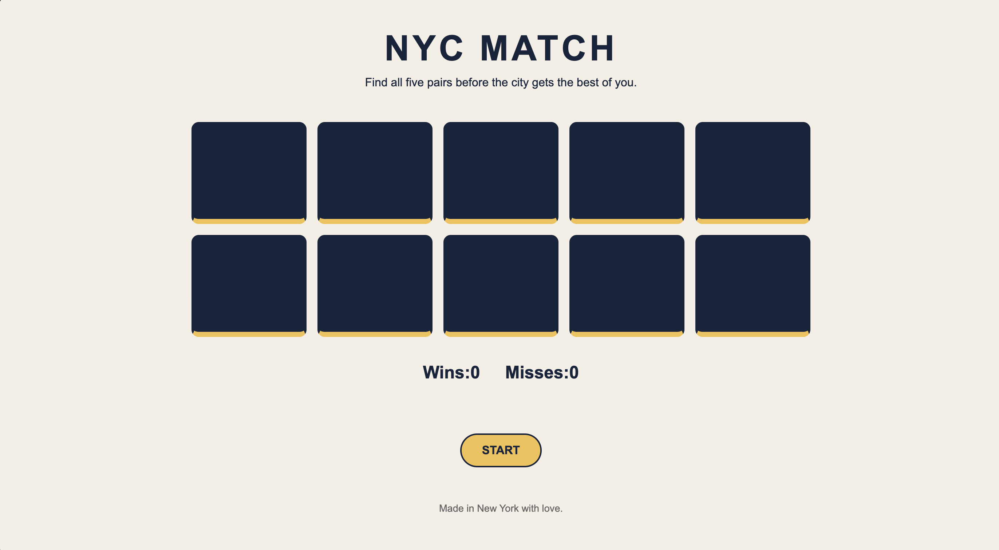
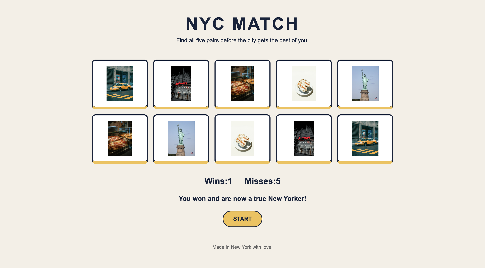

# NYC Match

A New York City-themed matching card game built with HTML, CSS, and JavaScript.

The goal is to find all five matching pairs while keeping track of your misses along the way. The cards feature familiar NYC-inspired images, including pizza, bagels, taxis, the Statue of Liberty, and the subway.

## How to Play

1. Click a card to reveal the image.
2. Choose a second card and try to find its match.
3. If the cards match, they stay revealed.
4. If they do not match, they flip back over and your miss count increases.
5. Find all five pairs to win the game.

When all five pairs are matched, the game displays a message letting you know that you are now a true New Yorker.

## How It Works

The game starts with ten cards made up of five matching pairs.

JavaScript creates a copy of the card deck and randomly assigns an image to each card. When a player selects two cards, the game compares their image sources to determine whether they match.

Matching cards remain visible. Cards that do not match are hidden again after a short delay, and the miss counter increases.

Once all five pairs have been found, the win counter increases and a winning message appears.

## Built With

- HTML
- CSS
- JavaScript
- DOM manipulation
- JavaScript event listeners

## Features

- Randomized card placement
- Five NYC-themed matching pairs
- Win and miss tracking
- Delayed card reset after an incorrect match
- Responsive layout for smaller screens
- Restart and reshuffle functionality

## Future Improvements

- Add a timer so players can challenge themselves to complete the game faster.
- Add difficulty levels with larger card grids and more matching pairs.
- Add a best-score system that tracks the fewest misses or fastest completion time.
- Add more NYC-themed card sets and allow players to choose between different categories.
- Add subtle card-flip animations and additional visual feedback when a match is found.
