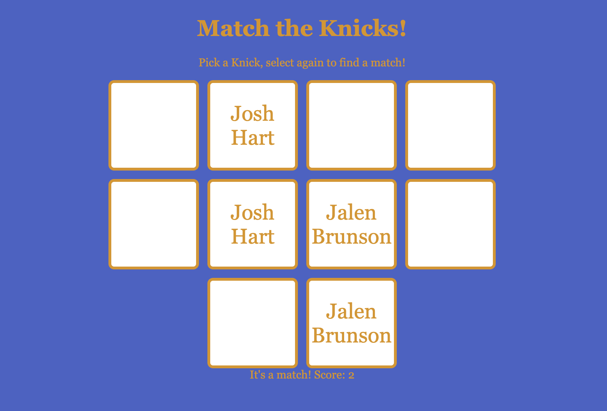

# Knicks Matching Game

A 10-card memory game: flip two cards, find the matching New York Knicks player, and match all five pairs.

Live demo: https://match-the-knicks.onrender.com



## What it does

- Ten face-down cards, shuffled into a random order every time the page loads.
- Click a card to reveal a Knick — KAT, Jalen Brunson, Josh Hart, Mikal Bridges, or OG — each appears twice.
- Click a second card: if they match, they stay flipped and you score a point; if not, they flip back over after one second.
- The server holds the shuffled deck and answers each flip (`GET /flip?index=…`) and each match check (`GET /match?first=…&second=…`).

## Tech stack

<<<<<<< HEAD

- Node.js — plain `http` and `fs` modules, no framework
- HTML, CSS, vanilla JavaScript
- figlet (for the 404 page)

## How to run it

```bash
npm install
node server.js
```

Open http://localhost:8000. There is no `npm start` script in this repo — run `node server.js` directly.

## Project structure

```
server.js            - Node http server (port 8000), shuffles the deck, /flip and /match endpoints
index.html           - the game board (10 cards, result and score)
js/main.js           - flip logic, match checking, score
css/style.css        - page styling
package.json         - dependencies (figlet)
```

---

# Thay Brown — thaybrown22@gmail.com · https://thaythecoder.netlify.app · https://github.com/tbrown320 · https://www.linkedin.com/in/thaybrown

- Set timeout to wait a second before flipping mismatches back over
- Learned how to save multiple clicks (selections) at one time to use as params
- Executing functions on the server side and just returning a json can help organize information
  > > > > > > > ea9026c39815ca2abf6484c773c476d332a13fbc
