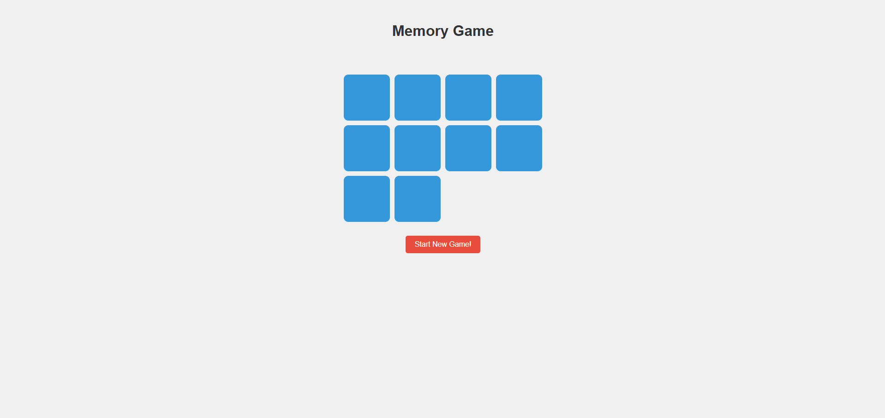

# Matching card!

A web application that lets users play a Memory matching game! 

## Tech Stack
- **Frontend:** HTML, CSS, and JavaScript

## Lessons Learned
- Learned how to take an array and push date from one array into that array!

## Image of Project:

