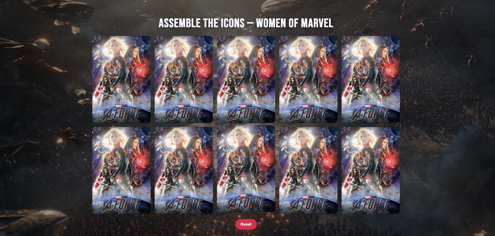

# Assemble the Icons — Women of Marvel

A cinematic memory matching game featuring the powerful women of the Marvel universe.  
Flip, match, and reveal each hero to complete the set.

[Link to project](https://matching-card-gamma.vercel.app/)  

---

## How It’s Made:
**Tech used:** HTML, CSS, JavaScript  

Each card flips using a simple transform animation and stays revealed when matched.  
The grid holds ten cards (five pairs) randomized on load, and the game ends when all matches are found.  
A minimal, cinematic interface centers everything with a battle-scene background and Marvel-style title font for added intensity.

---

## Optimizations
- Adjusted card dimensions for full-image visibility without distortion  
- Centered the full layout vertically and horizontally for a cleaner game stage  
- Added dark overlay for background clarity and better card contrast  
- Simplified flip logic and board reset for smoother play  
- Designed responsive breakpoints for consistent spacing on smaller screens

---

## Lessons Learned
- How to implement randomized grid logic using simple DOM order changes  
- Managing front/back card states and rotate transitions  
- Keeping visual balance between background and gameplay using overlays  
- Centering flex + grid elements together without breaking responsiveness  

---

## Next Steps
- Add hero fact reveals for each match  
- Optional background motion or music  
- Score tracking and completion animation  
- Sound effect integration for flip, match, and victory moments
